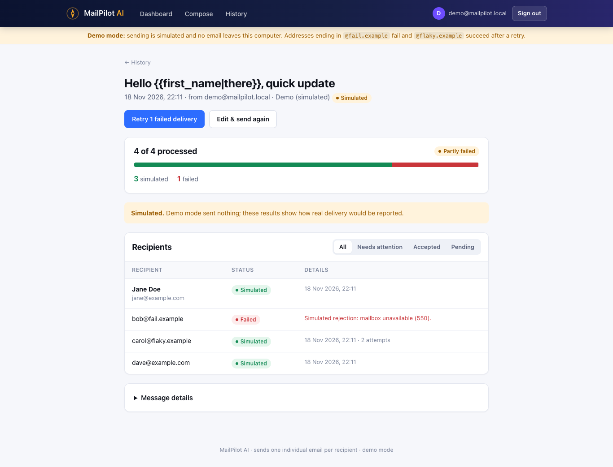
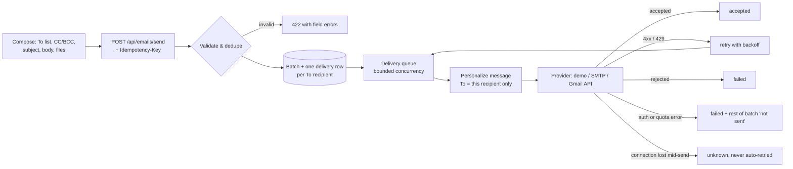

# MailPilot AI

**Write one email and send it to many people, each as their own private message.**

You enter 10 addresses, write one message and click Send. MailPilot sends **10 separate emails**, each addressed only to its recipient, so nobody sees who else received it. Then you see the result for every recipient.



## Why

Putting everyone in **To/CC** exposes every address. **BCC** hides them, but the email still looks like a bulk send and can't be personalized. MailPilot sends a real one-to-one email to each person, with optional `{{first_name}}`-style personalization, and tracks each delivery separately.

## Features

- **Individual delivery**: N recipients → N independent messages, each with exactly one address in `To`.
- **Recipient handling**: paste lists from a spreadsheet, `Name <email>` syntax, validation, automatic de-duplication across To/CC/BCC.
- **CC/BCC**: copied onto every individual message (e.g. a manager or an archive address).
- **Personalization**: `{{name}}`, `{{first_name}}`, `{{last_name}}`, `{{email}}` with fallbacks: `{{first_name|there}}`.
- **Rich text, HTML or plain text** bodies. HTML mails include an automatic plain-text alternative.
- **Attachments**: up to 5 files (PDF, Office, images, CSV/TXT). Type is checked by file content, not just the extension.
- **Preview**: step through exactly what each recipient will receive before sending.
- **Email-verified accounts**: sign-up requires a 6-digit code emailed to the address (expires in 2 minutes, limited attempts and resends).
- **Choose the From address**: defaults to your verified email; the mail server must authorize it, otherwise the send is rejected (no spoofing).
- **Progress & results** per recipient: accepted / failed / not sent / unknown, with error reasons, automatic retries for temporary failures, and a manual "retry failed".
- **Duplicate-send protection**: every send carries an idempotency key, so a double click or network retry never sends twice.
- **Demo mode**: explore everything with simulated sending and no email account.
- **Providers**: demo, generic SMTP (Gmail, Microsoft 365, any SMTP server), or the Gmail API via Google sign-in.

## Tech stack

| Layer    | Technology                                                                    |
| -------- | ----------------------------------------------------------------------------- |
| Frontend | React 19, React Router 7, Vite 8, plain CSS                                    |
| Backend  | Node.js 20+, Express 5, Nodemailer                                            |
| Storage  | SQLite (default, zero setup) or PostgreSQL (`DATABASE_URL`)                    |
| Auth     | Server-side sessions in HttpOnly cookies; bcrypt passwords; Google OAuth (optional) |
| Tests    | `node:test`, Supertest, an in-process SMTP server (no real email is ever sent) |

## How individual delivery works



The queue lives in the database, so no Redis is needed and queued messages survive a restart. "Accepted" means the provider's server took the message. It does **not** guarantee inbox delivery, because the recipient's server can still bounce or filter it.

## Quick start (demo mode, no configuration)

Requires **Node.js 20.19+**.

```bash
git clone <your-fork-url> mailpilot-ai
cd mailpilot-ai
npm run setup      # installs backend-node/ and web-ui/ dependencies
npm run dev        # API on :3400, web UI on http://localhost:5173
```

Open http://localhost:5173 and click **Explore the demo**. Without a `.env`, the backend runs in demo mode: sending is simulated, a banner says so, and nothing leaves your machine. Use `someone@fail.example` to see a rejection and `someone@flaky.example` to see a retry.

## Sending real email

Copy `backend-node/.env.example` to `backend-node/.env` and choose a provider. Real sending only happens when you set `EMAIL_PROVIDER` explicitly, and MailPilot never falls back to simulated sending if a real send fails.

**SMTP (one shared sender, password accounts)**

```ini
EMAIL_PROVIDER=smtp
SMTP_HOST=smtp.gmail.com          # or smtp.office365.com, or your provider's host
SMTP_PORT=587
SMTP_USER=you@gmail.com
SMTP_PASS=your-app-password       # Gmail: create an App Password (requires 2-Step Verification)
SMTP_FROM_EMAIL=you@gmail.com
SMTP_FROM_NAME=Your Name
```

Check it without sending anything: `npm run check:provider` (connects, authenticates, disconnects).

**Who can be the From address?** Only addresses the SMTP account is authorized to send as: `SMTP_FROM_EMAIL`, your `SMTP_USER` (if it is an address) and anything in `SMTP_ALLOWED_FROM` (addresses or `@domain`). By default each user's From is their own verified email, so with a personal Gmail SMTP account people must switch to an authorized sender; the compose screen warns and offers one-click choices. Verification codes are sent through the same SMTP account.

**Gmail API (each user sends from their own Gmail via Google sign-in)**: set `EMAIL_PROVIDER=gmail`, `GOOGLE_CLIENT_ID`, `GOOGLE_CLIENT_SECRET`, `GOOGLE_REDIRECT_URI` and `TOKEN_ENCRYPTION_KEY`. See [docs/deployment.md](docs/deployment.md#gmail-api-google-oauth) for the Google Cloud setup.

Provider credentials stay on the server. The browser only ever holds an HttpOnly session cookie.

## Configuration

Every backend setting is documented in [`backend-node/.env.example`](backend-node/.env.example). The most important:

| Variable                         | Default                 | Purpose                                                     |
| -------------------------------- | ----------------------- | ----------------------------------------------------------- |
| `EMAIL_PROVIDER`                 | `demo`                  | `demo`, `smtp` or `gmail`                                   |
| `APP_URL`                        | `http://localhost:5173` | Public URL of the UI (OAuth redirects, default CORS origin) |
| `DATABASE_URL`                   | empty → SQLite          | `postgres://…` to use PostgreSQL                            |
| `DATA_DIR`                       | `./data`                | SQLite file and temporary attachments                       |
| `ALLOW_REGISTRATION`             | on in dev, off in prod  | Open sign-up; otherwise `npm run create-user`               |
| `SEND_CONCURRENCY` / `SEND_DELAY_MS` | `2` / `200`         | Throttle toward your mail server                            |
| `MAX_TO`, `MAX_RECIPIENTS_PER_DAY` | `100`, `500`          | Per-email and per-user daily limits                         |

The server validates its configuration at startup and exits with a list of every problem it finds. The web UI has one optional build-time variable, `VITE_API_BASE_URL` (default `/api`); see [`web-ui/.env.example`](web-ui/.env.example).

## Commands

Run from the repository root:

| Command                  | What it does                                                   |
| ------------------------ | -------------------------------------------------------------- |
| `npm run setup`          | Install all dependencies                                       |
| `npm run dev`            | Run API + UI with reload                                       |
| `npm test`               | Backend tests (47) + frontend unit tests                       |
| `npm run lint`           | Lint the frontend                                              |
| `npm run build`          | Build the UI into `web-ui/dist`                                |
| `npm start`              | Start the API. It also serves `web-ui/dist` if it was built     |
| `npm run check:provider` | Validate config and test the provider connection (no sending)  |

Backend-only: `npm run migrate --prefix backend-node`, `npm run create-user --prefix backend-node -- you@example.com "Name"`. To run the test suite against PostgreSQL, set `TEST_DATABASE_URL`.

## Deployment

The simplest production setup is a single container, with the API serving the built UI and SQLite on a volume:

```bash
docker build -t mailpilot-ai .
docker run -p 3400:3400 -v mailpilot-data:/data --env-file backend-node/.env mailpilot-ai
```

Put it behind HTTPS, set `NODE_ENV=production`, `APP_URL` and `TRUST_PROXY=1`, and use `DATABASE_URL` for PostgreSQL if you prefer. `GET /health` is the health check. Full guide: [docs/deployment.md](docs/deployment.md). Architecture notes: [docs/architecture.md](docs/architecture.md). API reference: [backend-node/API.md](backend-node/API.md).

## Known limitations

- **No bounce or open tracking.** Results reflect what the sending server accepted, not inbox delivery.
- **Single sending worker per deployment.** Claiming deliveries is safe with several instances, but attachments live on local disk, so run one instance or share `DATA_DIR`.
- **Outlook / Microsoft 365** is supported through SMTP only. OAuth via Microsoft Graph is not implemented, and many tenants disable SMTP AUTH.
- **Gmail API mode** requires a Google Cloud OAuth app. Until Google verifies the app, only test users you add can sign in.
- **Templates for each recipient** are limited to name and email placeholders. There's no CSV import of custom fields yet.
- Despite the name, there are **no AI features** today.

## License

[MIT](LICENSE)
