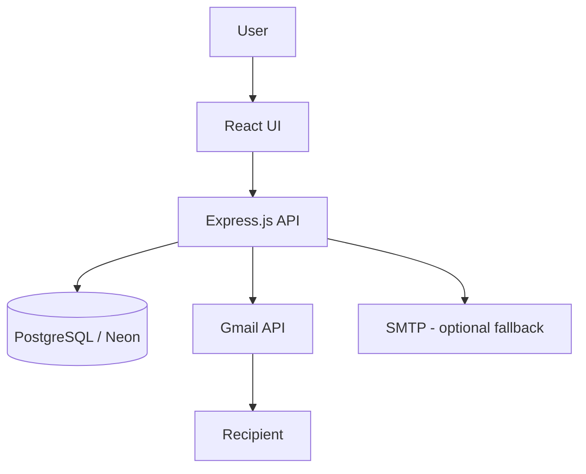
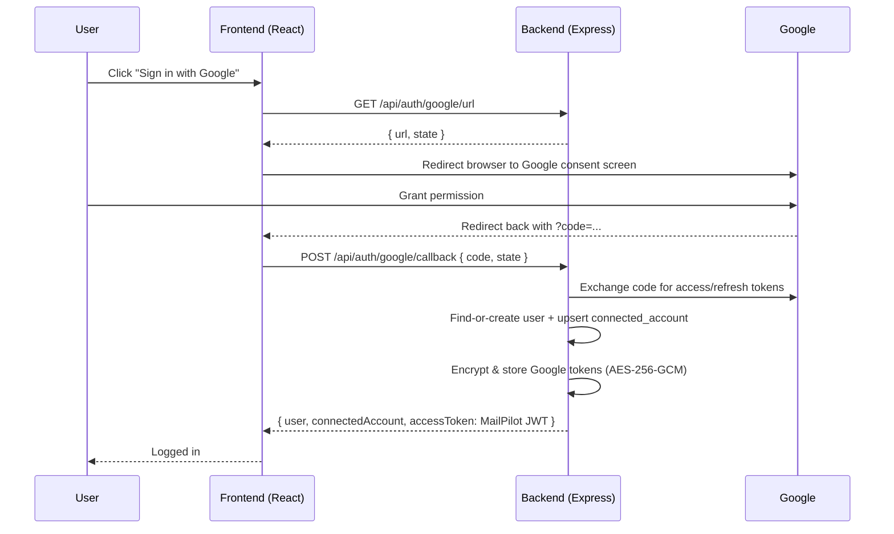
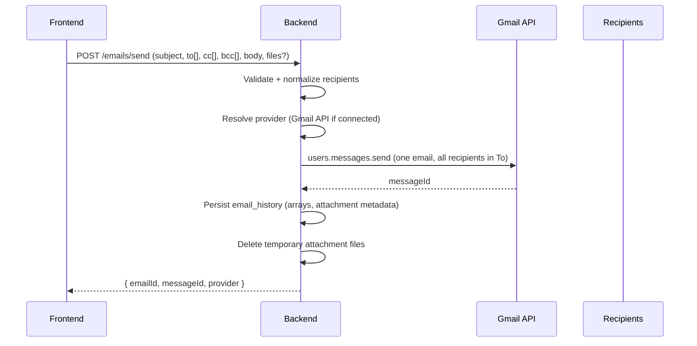
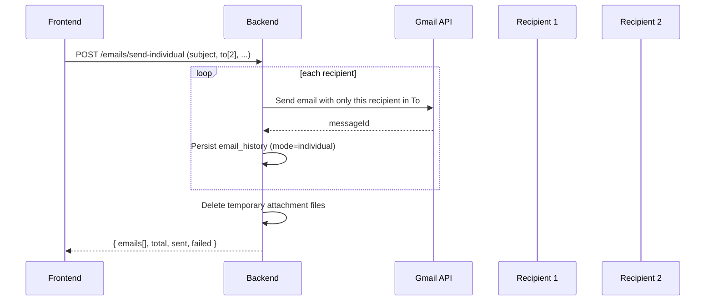
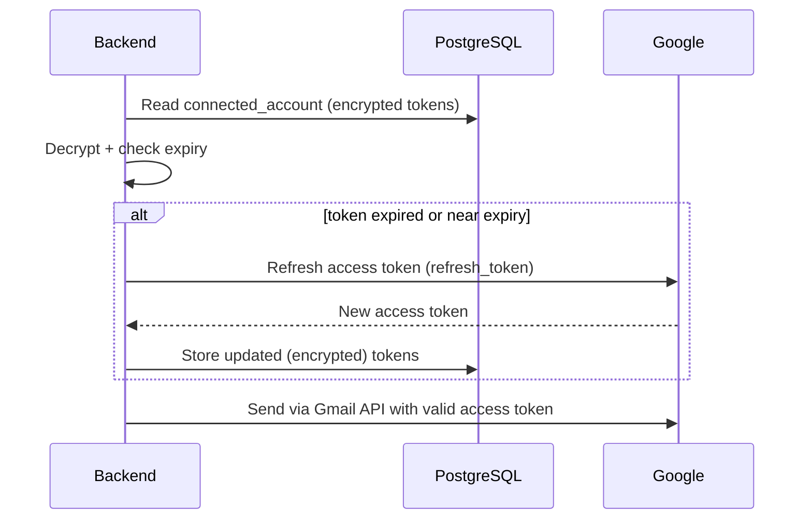
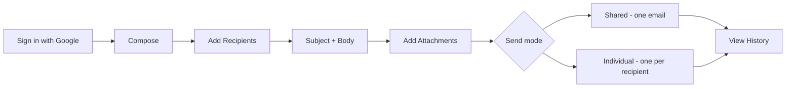

# MailPilot AI — System Design

> **Status:** Current
> Focused on the OAuth-only, provider-based Express.js + PostgreSQL design.

---

## High-Level Architecture

- **React UI** renders the compose flow and the "Sign in with Google" button.
- **Express API** handles OAuth sign-in, token storage, and email sending.
- **PostgreSQL** stores users, connected accounts (encrypted tokens), and email
  history.
- **Gmail API** sends email through the user's own mailbox.
- **SMTP** is an optional fallback provider when SMTP_HOST is configured.

## Authentication Flow (Google OAuth)

> The frontend receives **only the MailPilot JWT**. Google's access/refresh
> tokens never leave the server.

## Email Sending Flow

### Shared Email (`POST /api/emails/send`)

### Individual Emails (`POST /api/emails/send-individual`)

## Data Flow: Token Refresh

## User Flow

---

_Next: [03 — Technical Design](03-technical-design.md)_
