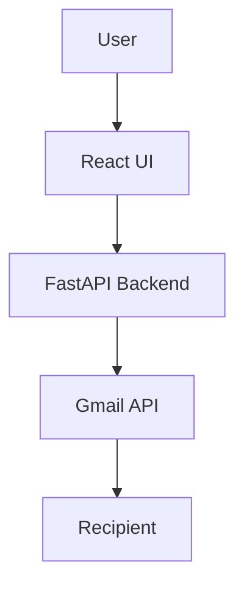
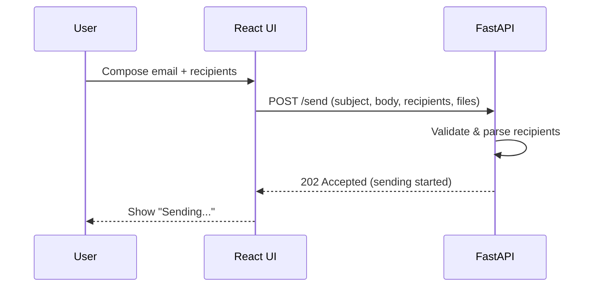
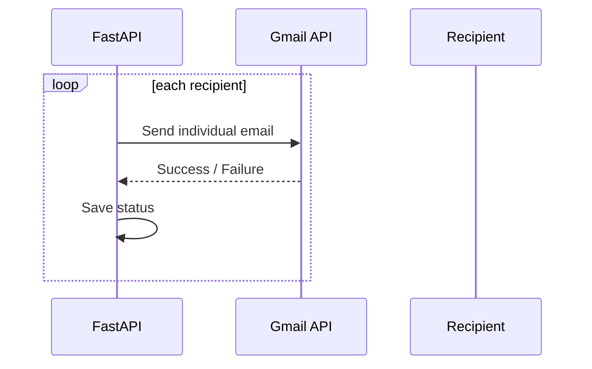
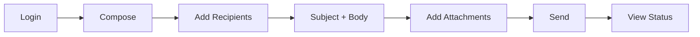

# MailPilot AI — System Design

> **Status:** Initial development phase (Phase 1)
> Focused on the simple, end-to-end flow for sending individual emails.

---

## Simple Architecture

## Request Flow

- The user fills the compose form and clicks **Send**.
- The React UI sends one request to the backend with all the email data.
- The backend validates and parses the recipients, then responds quickly.

## Email Sending Flow

- The backend loops through each recipient.
- It sends a **separate email** to each one via the Gmail API.
- It records the result (success or failure) for each recipient.

## User Flow

| Step                | What happens                                            |
| ------------------- | ------------------------------------------------------- |
| **Login**           | Basic placeholder login (full OAuth in a future phase). |
| **Compose**         | User writes the email in a form.                        |
| **Add Recipients**  | Enter emails separated by comma, newline, or pipe.      |
| **Subject + Body**  | Add the subject line and email body.                    |
| **Add Attachments** | Attach up to 5 files (PDF, DOC/DOCX, CSV).              |
| **Send**            | Click send to deliver one email per recipient.          |
| **View Status**     | See success/failure for each recipient.                 |

---

_Next: [03 — Technical Design](03-technical-design.md)_
