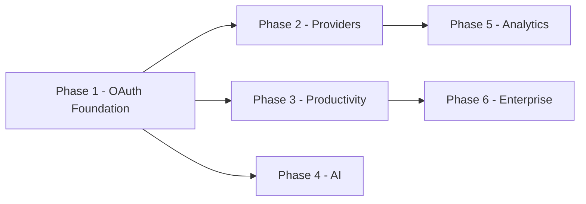

# MailPilot AI — Roadmap

> **Status:** Living document
> Organized by phases. Each phase builds on the previous one.

---

## Phase 1 — OAuth Foundation (Current)

- ✅ OAuth-only authentication (no passwords)
- ✅ Sign in with Google (Authorization Code flow)
- ✅ Connect Gmail account, send via Gmail API
- ✅ Encrypted OAuth token storage + automatic refresh
- ✅ Provider-based OAuth + email provider architecture
- ✅ Shared email send (`POST /emails/send`)
- ✅ Individual email send (`POST /emails/send-individual`)
- ✅ Temporary attachments (deleted after send; metadata only)
- ✅ Email history
- ✅ Swagger docs (`/api/docs`)
- ✅ Free-tier deployment ready (Neon + Railway)

## Phase 2 — More Providers

- [ ] Outlook
- [ ] Microsoft 365
- [ ] Zoho
- [ ] Yahoo

> Each is a new OAuth adapter + email provider class. No architectural changes.

## Phase 3 — Productivity

- Templates
- Better UI
- Search
- Drafts
- Re-send failed emails

## Phase 4 — AI Features

- AI Email Generation
- AI Reply Suggestions
- AI Subject Generator
- Grammar Improvement
- Follow-up Suggestions

## Phase 5 — Delivery & Analytics

- Scheduling
- Analytics
- Delivery Status
- Retry Failed Emails

## Phase 6 — Enterprise

- Teams
- Organizations
- Roles & Permissions
- SendGrid / Mailgun / AWS SES providers

---

## Phase Dependencies

---

_Next: [Documentation Index](README.md)_
