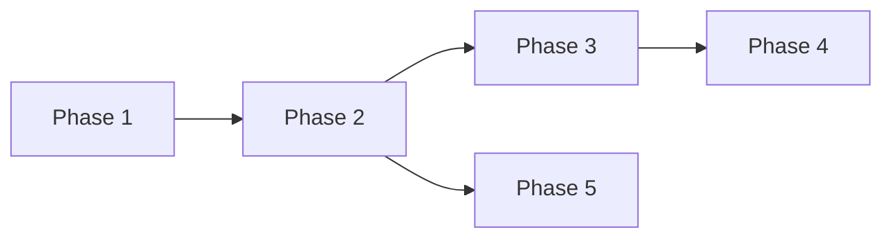

# MailPilot AI — Roadmap

> **Status:** Living document
> Organized by phases. Each phase builds on the previous one.

---

## Phase 1 — Core (Current)

Foundation for the whole app.

- Compose Email
- Multiple Recipients
- Attachments (up to 5)
- Send Email
- Basic History

## Phase 2 — Productivity

- Templates
- Google OAuth login
- Better UI
- Search
- Drafts

## Phase 3 — Delivery & Analytics

- Scheduling
- Analytics
- Delivery Status
- Retry Failed Emails

## Phase 4 — AI Features

- AI Email Generation
- AI Subject Generator
- Grammar Improvement
- Follow-up Suggestions

## Phase 5 — Enterprise

- Outlook Integration
- AWS SES
- SendGrid
- Teams
- Organizations
- Roles & Permissions

---

## Phase Dependencies

- Phase 2 needs the Phase 1 composer and history.
- Phase 3 needs Phase 2 delivery + better UI.
- Phase 4 adds AI on top of a working compose + history.
- Phase 5 adds enterprise features and integrations.

---

_Next: [Documentation Index](README.md)_
