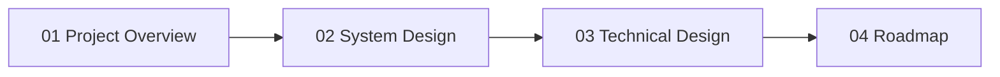

# MailPilot AI — Documentation

Clean, easy-to-read documentation for the MailPilot AI platform — send **one personalized email to many recipients** as individual emails.

## Documentation Index

| Document                                        | Purpose                                                            |
| ----------------------------------------------- | ------------------------------------------------------------------ |
| [01 — Project Overview](01-project-overview.md) | Vision, problem, solution, target users, features, business model. |
| [02 — System Design](02-system-design.md)       | Architecture, request flow, email sending flow, user flow.         |
| [03 — Technical Design](03-technical-design.md) | Tech stack, folder structure, API, validation, error handling.     |
| [04 — Roadmap](04-roadmap.md)                   | Phased plan from core to enterprise features.                      |

## Reading Order

1. Start with the **Project Overview** to understand the product.
2. Read the **System Design** for the high-level flow.
3. Dive into the **Technical Design** for implementation details.
4. Reference the **Roadmap** to see what comes next.

---

## Conventions

- **Diagrams:** Mermaid — render in any Mermaid-compatible viewer (GitHub, VS Code).
- **Callouts:** `> [!NOTE]` highlights important guidance.
- **Status:** Every document notes whether it is current (Phase 1) or future scope.
